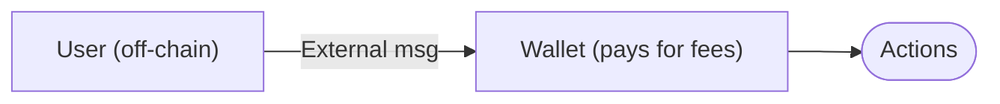
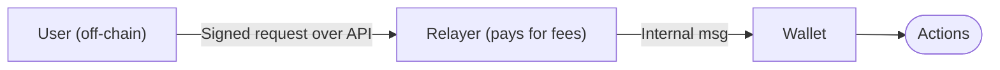

Gasless transactions allow the wallet owner to not hold Gram for [network fees](/foundations/fees). Such requests use internal messages submitted by a relayer — its service and on-chain contract submit transactions on behalf of users and attach Gram to cover network fees when the wallet balance is zero. Otherwise, its existing balance can fund its own operations.

<Callout type="note">
  The wallet contract must support owner-signed internal messages — implementations that accept only external messages cannot participate in gasless flows.
</Callout>

## How it works

### Core mechanism

TON contracts process external-in and internal messages:

- External-in messages arrive from outside the blockchain. The wallet pays transaction costs from its account balance.
- Internal messages arrive from other contracts. The incoming value is credited to the wallet before execution; transaction costs are debited from its balance.

An internal message's initial gas limit depends on its incoming value. [WalletTg](/contracts/standard/wallets/telegram/overview) does not call `ACCEPT` for internal requests, so the relayer must attach enough Gram for compute even when the wallet has an existing balance.

### Architecture

Regular transfers:

Gasless transfers:

Three components enable gasless transactions:

1. Wallet contract with authenticated internal message support
1. Relayer service that validates and submits transactions
1. Signature scheme that proves user authorization

### Transaction flow

#### Step 1: User creates signed payload

The user's wallet application:

- Constructs an action list (transfers, contract calls)
- Adds replay protection (sequence number, expiration timestamp)
- Signs with the wallet's private key
- Sends signed payload to relayer via an API

#### Step 2: Relayer validates

The relayer verifies off-chain:

- Signature is authentic (confirmed with the wallet's public key)
- Sequence number matches the current wallet state
- Expiration timestamp is valid
- Payment terms are met (if applicable)

#### Step 3: Relayer submits internal message

The relayer's wallet sends an internal message to the user's wallet:

- Attaches enough Gram for compute and any outgoing costs the wallet balance cannot cover
- Forwards the signed request body unchanged
- Pays the message value and its own sending fees from the relayer's balance

#### Step 4: Wallet executes

The wallet contract:

- Verifies signature on-chain
- Checks replay protection
- Executes signed actions using the incoming value and any existing balance
- Updates replay-protection state

The blockchain sees a standard internal message. Authentication happens inside the wallet contract.

## Payment models

Relayers use different models to recover gas costs:

- Jetton payment: the user includes a [jetton transfer](/contracts/standard/tokens/jettons/transfer) to the relayer in the signed action list. The relayer receives jettons only if the downstream transfer succeeds.
- Prepaid credits: the user purchases credits off-chain. The relayer deducts credits per transaction. No on-chain payment.
- Sponsorship: the relayer covers costs without payment. Common for onboarding, promotions, or subsidized dApp actions. Requires abuse prevention (rate limits, address restrictions).

## Security

### Cryptographic protection

The wallet contract must verify the signature and replay-protection fields on-chain. When it verifies the complete request, a relayer cannot change the signed actions without invalidating the signature.

For example, [WalletTg](/contracts/standard/wallets/telegram/overview) signs the request body, including its opcode, header, and outgoing-message cells. The internal message sender and attached value are outside that signature.

Sequence-number and expiry checks prevent replay according to the selected wallet's rules. They do not guarantee that a relayer will submit the request or that a state-dependent action will have the same outcome later.

### Relayer trust requirements

The relayer controls whether and when it submits a request. It can:

- Refuse to submit transactions (censorship)
- Delay submission
- Observe the signed request before submission

If compromised, the relayer service may also expose request metadata, such as user IP addresses. The wallet signature prevents the relayer from changing authenticated actions or creating a new authorized request; it does not protect privacy, availability, or actions the owner signed.

If the relayer refuses or delays submission, use another compatible relayer.

### MEV and front-running

The relayer sees the request before submission and can delay it or submit another transaction first. State-dependent dApp actions, such as swaps, may then fail or execute under changed conditions. The signature protects the action fields, not market state or transaction ordering.

Mitigate state and timing risks by:

- Setting a request expiry that allows for user approval and relay time.
- Including application-level limits, such as a swap's minimum output and deadline.
- Sending a direct external request when the wallet has enough Gram.
- Checking the final on-chain result.

### Operational risks

- Insufficient Gram: execution can fail if the incoming value does not buy enough compute or the total balance cannot cover outgoing values and fees. Retry only after checking that the current `seqno` still matches and the signed request has not expired.
- Network congestion can delay message delivery. Network fees follow fee parameters and transaction shape; they do not rise with load like gas-auction prices.
- Jetton transfers execute through downstream messages. A successful wallet transaction only confirms that transfer messages were sent; follow the transaction chain to confirm each recipient and any jetton reimbursement.
- Jetton payment risks: jetton contracts may have restrictions, insufficient balance, or bugs. Relayers should emulate transactions off-chain before spending Gram.
- Prepaid credit risks: users trust the relayer to honor off-chain credit balances. No on-chain recourse if the relayer refuses service.
- Sponsorship abuse: without rate limits and address restrictions, attackers can drain relayer resources through spam.

## Example: jetton payment

Alice has zero Gram and wants to transfer 100 USDT to Bob. The relayer charges 0.5 USDT. Alice signs two actions: a 100 USDT [jetton transfer](/contracts/standard/tokens/jettons/transfer) through her jetton wallet and a 0.5 USDT transfer to the relayer. With [WalletTg](/contracts/standard/wallets/telegram/overview), both are outgoing messages in the signed request.

The relayer emulates the full transaction chain using current state and fee parameters. For illustration, assume it estimates 0.04 GRAM for wallet execution and fees, and 0.05 GRAM in outgoing message value for each jetton transfer. The relayer attaches 0.16 GRAM. The WalletTg transaction spends 0.04 GRAM in fees and sends 0.10 GRAM in message values, leaving an estimated 0.02 GRAM in the wallet at that point. The relayer also pays its own fees to send the internal message.

The values illustrate a budget calculation, not a fee quote. Jetton-wallet contracts process the outgoing messages asynchronously. Their transactions may consume, return, or bounce Gram. The relayer must confirm that its jetton payment succeeded, not only that WalletTg accepted the request.

On confirmed completion:

- Alice's jetton balance decreases by 100.5 USDT.
- Bob receives 100 USDT.
- The relayer's jetton wallet receives 0.5 USDT.
- Any Gram left in WalletTg or returned by downstream messages remains subject to later transactions and fees.

A relayer that accepts USDT reimbursement can accumulate the jettons and exchange them for Gram periodically.

## Limitations

- **Not a protocol feature:** gasless transactions are an application-layer pattern. The blockchain does not enforce or guarantee relayer behavior.

- **Centralization of transactions:** users depend on relayer uptime, policies, and willingness to serve requests. Relayers can censor addresses or refuse to provide the service.

- **Wallet requirement:** the wallet contract must support authenticated internal messages. Wallet V5 and [WalletTg](/contracts/standard/wallets/telegram/overview) support owner-signed internal requests, but use different formats. Relayers must implement the selected wallet's format and validation rules; the [WalletTg message reference](/contracts/standard/wallets/telegram/messages) defines its format.

- **No standardization:** relayer APIs, fee structures, and supported assets vary. Each integration requires custom implementation.

- **Mandatory** [TON Connect](/applications/ton-connect/overview) **flows:** `sendTransaction` submits a transaction through the connected wallet. [`signMessage()`](/applications/ton-connect/api-reference/sdk#signmessage) can return a signed message without broadcasting it when the connected wallet advertises the `SignMessage` feature. The [gasless `signMessage()` guide](/applications/ton-connect/how-to/sign-message-gasless) shows its Wallet V5 flow.

<Callout type="note">
  WalletTg's owner-signed internal request support does not imply that Telegram Money advertises `SignMessage` or that an existing relayer accepts WalletTg's request format.
</Callout>

## Implementation

### Wallet contract requirements

- Accept authenticated internal messages signed by the wallet owner
- Enforce replay protection (sequence numbers, expiration timestamps) for both external and internal messages
- Use distinct operation codes for external and internal entry points to prevent cross-channel replay attacks

### Relayer requirements

- Validate signatures and replay protection off-chain before spending Gram
- Attach enough Gram for compute and any outgoing costs the wallet balance cannot cover
- Implement rate limiting and abuse prevention
- For jetton payments, emulate transactions to verify successful execution
- Forward the signed payload verbatim in the internal message body without modifying fields covered by the signature

### Example: wallet v5

The [wallet v5](/contracts/standard/wallets/v5) standard supports gasless via the `internal_signed` message format:

- Separate opcodes for external and internal messages prevent replay attacks
- The contract enforces signature verification, sequence numbers, and expiration checks for owner-signed internal messages
- A relayer forwards the signed payload verbatim as the internal message body and attaches Gram for gas
