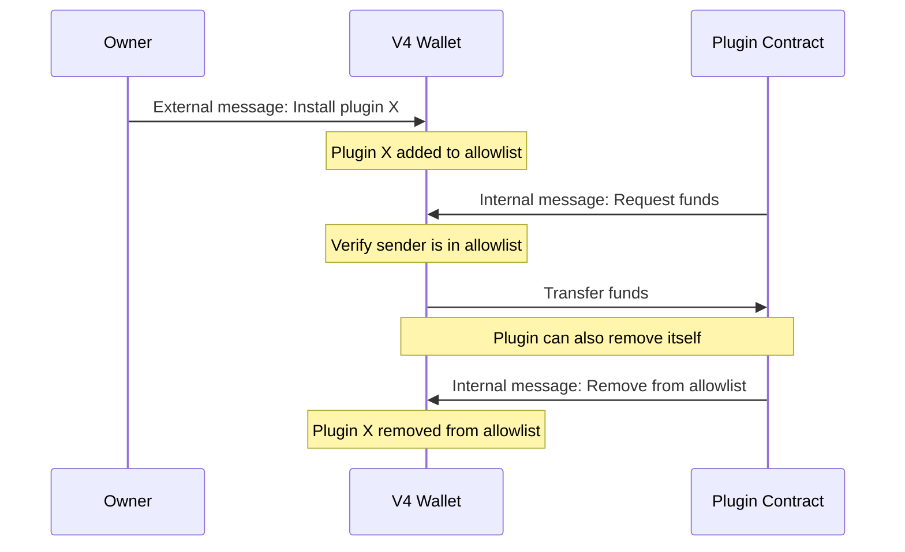

| Contract version | Hash                                                               | Link                                                                                                                             |
| ---------------- | ------------------------------------------------------------------ | -------------------------------------------------------------------------------------------------------------------------------- |
| V4 R1            | `64dd54805522c5be8a9db59cea0105ccf0d08786ca79beb8cb79e880a8d7322d` | [Source](https://github.com/ton-blockchain/wallet-contract/blob/0f9e25acd61a8384887f4d6c017b8cdbd7cf2213/func/wallet-v4-code.fc) |
| V4 R2            | `feb5ff6820e2ff0d9483e7e0d62c817d846789fb4ae580c878866d959dabd5c0` | [Source](https://github.com/ton-blockchain/wallet-contract/blob/4111fd9e3313ec17d99ca9b5b1656445b5b49d8f/func/wallet-v4-code.fc) |

This version retains all the functionality of the previous versions and introduces plugins.

Plugins are separate smart contracts that can request assets from a V4 wallet after the owner installs them with a signed request. A plugin can request Gram and extra currencies for its own address; it cannot choose an arbitrary recipient. The wallet checks that its balance, excluding the request's attached value, covers the requested Gram. The send action can still fail if the requested extra currencies are unavailable.

View the original [wallet V4 source code](https://github.com/ton-blockchain/wallet-contract) or the code of an [example subscription plugin](https://github.com/ton-blockchain/wallet-contract/blob/main/func/simple-subscription-plugin.fc).

## Plugins

<Callout type="danger">
  Installing third-party plugins can be dangerous and may lead to wallet drainage. Only install plugins from trusted sources and ensure you understand their functionality before installation.
</Callout>

<Callout type="caution">
  Due to security reasons mentioned above, it is not possible to install plugins using [TON Connect](/applications/ton-connect/overview).
</Callout>

Plugins are essentially other smart contracts on TON that developers are free to implement as they wish. In relation to the wallet, they are simply addresses of smart contracts stored in a dictionary in the wallet's persistent memory. These plugins are allowed to request funds and remove themselves from the "allowed list" by sending internal messages to the wallet.

### Plugin interaction flow



## Persistent memory layout

V4 stores its persistent state in a cell; see [TL-B and dictionary serialization](/foundations/tlb/overview).

```tlb
contract_state$_
  seqno:(## 32)
  wallet_id:(## 32)
  public_key:(## 256)
  plugins:(HashmapE 264 Unit) = ContractState;
```

- `seqno`: 32-bit long sequence number.
- `wallet_id`: 32-bit long wallet\_id. This is a number that allows you to create multiple wallets with the same private key but different addresses.
- `public_key`: 256-bit long public key.
- `plugins`: dictionary keyed by an 8-bit signed workchain ID and a 256-bit address hash. Each key maps to `Unit` (an empty value); the key width is 264 bits.

<Callout type="tip">
  Default value for wallet\_id is `698983191` in V4, it is a partial hash of TON Mainnet zero state.
</Callout>

## Receiving internal messages

V4 accepts incoming funds from any sender. It interprets an [internal message](/foundations/messages/internal) as a plugin operation only when the body has a recognized opcode and the sender is installed.

- `opcode` (optional): 32-bit long operation code. This is an optional field. Any message containing less than 32 bits in the message body, an incorrect opcode, or a sender address that isn't registered as a plugin will be considered a simple transfer, similar to previous wallet versions.
- `query_id`: 64-bit identifier immediately after the opcode. It does not affect wallet behavior; it correlates the request and response.

1. opcode = `0x706c7567`, request funds operation.
   - `amount`: [Coins](/tvm/instructions#fa02-stgrams) amount of requested Gram.
   - `extra_currencies`: dictionary containing the amount of requested extra currencies (may be empty).
1. opcode = `0x64737472`, request removal of the plugin that sent this message from the allowed list.

TL-B for plugin operations:

```tlb
request_funds#706c7567
  query_id:(## 64)
  amount:Coins
  extra_currencies:ExtraCurrencyCollection = InternalMsgBody;

self_destroy#64737472
  query_id:(## 64) = InternalMsgBody;
```

For a funds request, V4 sends the requested assets to the plugin address in a reply with opcode `0xf06c7567` and the same `query_id`. A removal request deletes only the sending plugin.

## External message body layout

An [external-in message](/foundations/messages/external-in) to V4 has this body layout:

- `signature`: 512-bit long [Ed25519](https://en.wikipedia.org/wiki/EdDSA#Ed25519) signature.
- `wallet_id`: 32-bit long subwallet ID.
- `valid_until`: 32-bit long Unix time integer.
- `msg_seqno`: 32-bit long sequence number.
- `opcode`: 32-bit long operation code.
- other data depending on the opcode

Next, let's explore the types of messages:

### Simple send (opcode = 0x0)

The simple send operation processes a chain of messages, where each message contains a mode and a reference to the actual message cell:

<Image
  src="/images/wallets/simple_opcode_light.svg"
  darkSrc="/images/wallets/simple_opcode_dark.svg"
  alt="Simple send operation message chain"
/>

**Processing logic:**

```func
if (op == 0) { ;; simple send
  while (cs.slice_refs()) {
    var mode = cs~load_uint(8);
    send_raw_message(cs~load_ref(), mode);
  }
}
```

- `mode`: up to four 8-bit integers defining the sending mode for each message.
- `out_msg`: up to four references to cells containing messages.

### Deploy and install plugin (opcode = 0x1)

```tlb
deploy_and_install_plugin#01
  workchain:(## 8)
  balance:Coins
  state_init:^Cell
  body:^Cell
= WalletAction;
```

Deploys a new plugin contract and adds it to the wallet's plugin allowlist:

- `workchain`: 8-bit workchain ID where the plugin will be deployed
- `balance`: Initial Gram balance for the plugin contract
- `state_init`: Cell reference containing the plugin's initial state and code
- `body`: Cell reference containing the deployment message body

### Install plugin (opcode = 0x2)

```tlb
wc_n_address#_ wc:(## 8) hash:(## 256) = WorkchainWithAddress;

install_plugin#02
  wc_n_address:WorkchainWithAddress
  balance:Coins
  query_id:(## 64)
= WalletAction;
```

Adds an existing plugin contract to the wallet's allowlist:

- `wc_n_address`: Combined 8-bit workchain ID and 256-bit plugin address
- `balance`: Gram amount to send during installation
- `query_id`: 64-bit identifier for tracking the operation

### Remove plugin (opcode = 0x3)

```tlb
wc_n_address#_ wc:(## 8) hash:(## 256) = WorkchainWithAddress;

remove_plugin#03
  wc_n_address:WorkchainWithAddress
  balance:Coins
  query_id:(## 64)
= WalletAction;
```

Removes a plugin from the wallet's allowlist:

- `wc_n_address`: Combined 8-bit workchain ID and 256-bit plugin address
- `balance`: Gram amount
- `query_id`: 64-bit identifier for tracking the operation

Wallet V4 provides standard functionality through the `0x0` opcode, similar to previous versions (see [wallet overview](/contracts/standard/wallets/history) for details on message layout). The `0x2` and `0x3` operations allow manipulation of the plugin dictionary.

## Exit codes

The following [exit codes](/tvm/exit-codes) are specific to V4:

| Exit code | Description                                                             |
| --------- | ----------------------------------------------------------------------- |
| 33        | `seqno` check failed, replay protection triggered                       |
| 34        | `wallet_id` does not match the stored one                               |
| 35        | `signature` check failed                                                |
| 36        | `valid_until` check failed, transaction attempted too late              |
| 39        | Plugins dictionary manipulation failed (0x1-0x3 recv\_external opcodes) |
| 80        | Not enough funds for the plugin funds request                           |
| 0         | Standard successful execution exit code.                                |

## Get methods

These read-only methods expose the wallet's sequence number, public key, wallet ID, and installed plugins.

1. `int seqno()` returns current stored seqno.
1. `int get_public_key()` returns current stored public key.
1. `int get_subwallet_id()` returns current subwallet ID.
1. `int is_plugin_installed(int wc, int addr_hash)` checks if plugin with defined workchain\_id and address hash is installed. Returns `-1` (true) if the plugin is installed, `0` (false) if not installed.
1. `tuple get_plugin_list()` returns list of plugins.
