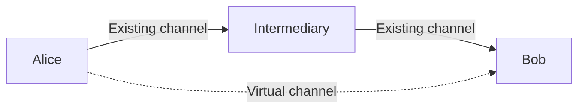
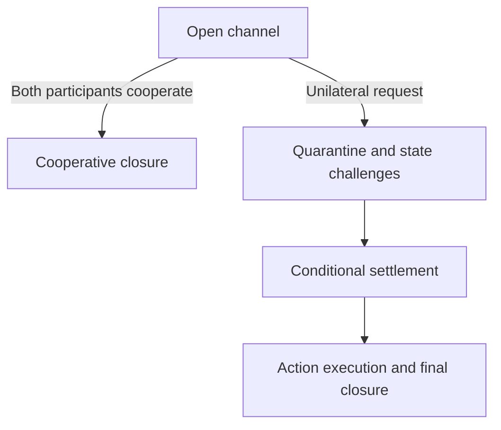

TON Payment Network records payments as signed commitments between participants. Funds held in smart contracts back those commitments, while virtual channels extend payments across a route of connected participants.

## Channel participants and funds

A payment channel connects two payment nodes. Each participant has a wallet for funding and a channel contract for on-chain operations. The nodes exchange and store signed states off-chain; the contracts enforce settlement on-chain.

[Channel initialization](/foundations/web3/payment-network/use-channels#initialize-the-channel) first establishes the participants' signed configuration. Deployment, activation, and deposits involve blockchain transactions. An initialized off-chain channel is therefore different from a funded channel ready for payments.

The node's wallet balance is separate from its channel funds. Adding funds to the wallet does not itself increase a channel's capacity unless the node deposits those funds into the channel.

## Signed states and available capacity

An agreed channel state includes a sequence number and commitments to each participant's conditional obligations and actions. Both participants sign the state. Subsequent updates advance the sequence number, allowing settlement to distinguish newer agreements from older ones.

Conditional obligations reserve funds for payments whose final amount or settlement is still pending. Actions describe operations such as transfers that the contract can execute. Signed commitments allow these obligations to change without submitting every update to the blockchain.

Available outgoing capacity accounts for deposits, action balances, funds on hold, and capacity reserved for conditionals. A wallet balance or on-chain deposit alone does not describe how much the node can spend through a channel.

For example, assume a participant has 3 GRAM in a channel, no action balance adjustments, and 1 GRAM reserved for a conditional payment. With no other holds, 2 GRAM remains available for further commitments. This illustrates capacity accounting, not a required deposit amount.

Capacity is directional. Sending through a peer uses local outgoing capacity; receiving through that peer requires capacity on its side. Each [asset](/foundations/web3/payment-network/reference#assets-and-amounts) has its own balance accounting and acceptance policy.

The node preserves signed states and their associated action and conditional data in its database. Keeping both this data and the private keys is necessary to continue operating the channel and participate in settlement.

## Routed payments and virtual channels

A sender does not need a direct funded channel with every recipient. A virtual channel connects the sender and recipient through conditional commitments in existing channels.

In this route, Alice needs outgoing capacity toward the intermediary, and the intermediary needs outgoing capacity toward Bob. Opening the virtual channel reserves the required capacity along the route, including the agreed fees. It does not deploy a new channel contract between Alice and Bob.

Each intermediary accepts forwarding terms and a deadline for its conditional commitment. The route must leave enough time for settlement under the underlying channels' closure rules. A route can fail even when the sender's wallet is funded: a required channel, asset, or outgoing capacity may be unavailable.

An intermediary can charge for [providing capacity](/foundations/web3/payment-network/use-channels#send-a-payment). These fees are separate from blockchain transaction fees.

## Repeated payments and virtual-channel settlement

A reusable virtual channel has a capacity, a deadline, and a signing key. The sender signs states containing the cumulative payment amount. A valid update cannot reduce that amount or exceed the channel's capacity.

The recipient receives the signed state, not the sender's private signing key.

To settle, the recipient supplies the signed state. The nodes validate it and convert the signed amount into a transfer commitment, accounting for the agreed fees and any prepayment. This updates the balances calculated off-chain without an immediate blockchain transfer. The resulting balances determine the capacity available for subsequent payments.

Settling a virtual channel does not close the underlying payment channels. The one-shot transfer flow settles its virtual payment automatically; a reusable virtual channel allows successive signed updates before settlement. Command semantics are in [Virtual-channel commands](/foundations/web3/payment-network/reference#virtual-channel-commands).

[TON Tunnel](/foundations/web3/ton-tunnel/architecture#traffic-payments) uses virtual-channel updates to prepay relay traffic. Packet-credit accounting belongs to Tunnel rather than the payment-channel protocol.

## On-chain settlement and closure

Off-chain settlement updates the participants' agreed balances. Executing payment actions, closing the channel, and withdrawing remaining funds are separate operations.

When the participants cooperate, both sign the required operation. A cooperative commit executes agreed actions on-chain; cooperative closure ends the channel. These are distinct operations.

Without cooperation, a participant can initiate closure using the supported signed state. The contract enters a quarantine period during which a newer valid state can challenge an older submission. Conditional settlement and action execution then follow the contract's deadlines before final closure.

The [unilateral process](/foundations/web3/payment-network/use-channels#close-the-channel) requires the relevant state and action data, transaction fees, and timely processing of [settlement steps](/foundations/web3/payment-network/reference#closure-settings). Submitting a closure request does not mean the funds have already returned.

## Sources

- [Channel operations and virtual-channel settlement](https://github.com/xssnick/ton-payment-network/blob/b5187d050c1cac581708c919e783e378b15a78c4/tonpayments/api.go#L366-L550)
- [Channel state updates and signatures](https://github.com/xssnick/ton-payment-network/blob/b5187d050c1cac581708c919e783e378b15a78c4/tonpayments/state.go#L754-L797)
- [Channel structures and available balance calculation](https://github.com/xssnick/ton-payment-network/blob/b5187d050c1cac581708c919e783e378b15a78c4/pkg/payments/types.go#L497-L521)
- [Off-chain channel balance accounting](https://github.com/xssnick/ton-payment-network/blob/b5187d050c1cac581708c919e783e378b15a78c4/tonpayments/db/types.go#L285-L386)
- [Virtual-channel states, capacity checks, and execution](https://github.com/xssnick/ton-payment-network/blob/b5187d050c1cac581708c919e783e378b15a78c4/pkg/payments/conditionals/channel.go#L415-L623)
- [Conditional settlement dispatch](https://github.com/xssnick/ton-payment-network/blob/b5187d050c1cac581708c919e783e378b15a78c4/tonpayments/conditional_settlement.go#L11-L22)
- [Universal channel contract](https://github.com/xssnick/payment-channel-contract/blob/9704af6a04b4dfedebb56f4261a07bd5578b667d/contracts/universal/payment-channel-contract.tolk#L180-L312)
