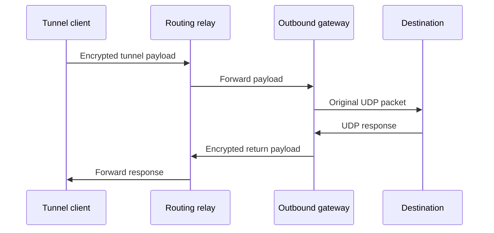
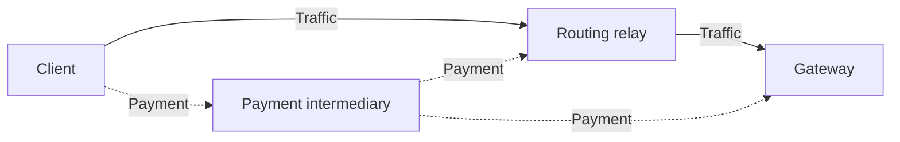

TON Tunnel gives an application a UDP endpoint on a remote gateway. The client builds routes through relays to carry outgoing packets and return responses. In ADNL Tunnel v0.2.2, relays can forward traffic for free or receive payments through TON Payment Network.

## Components and responsibilities

The tunnel client runs inside an application that integrates the library, such as a TON proxy. It selects relays from a configured pool and supplies the instructions needed to forward traffic.

A routing relay forwards tunnel messages to the next participant. The outbound gateway is the relay at the end of the outgoing route: it allocates a UDP socket, sends packets to their destinations, and receives responses. A tunnel with one relay uses that relay as the gateway.

Only packets passed to the [application's tunnel integration](/foundations/web3/ton-tunnel/use) use these routes. The tunnel does not redirect every connection made by the application or device.

## Route establishment

The client selects a gateway and, for a longer route, intermediate relays. It constructs outgoing and returning routes; their intermediate relays and order can differ.

Each route consists of sections, with encryption keys and instructions for the participant processing each section. The client creates these keys and instructions to establish forwarding state and connect the gateway's UDP endpoint to a return route.

The gateway reports its allocated address and port through that return route. During setup, relays cache forwarding instructions so traffic packets do not need to carry the full route setup each time. Separate control messages maintain the tunnel and carry payment updates.

The pool determines which relays are eligible. Its format and route-length setting are described in [Client configuration and node pools](/foundations/web3/ton-tunnel/reference#client-configuration-and-node-pools).

## Packet journey

The following example uses the same intermediate relay in both directions. A shorter tunnel can connect the client directly to the gateway.

The client wraps the destination IP address, port, and packet bytes in an encrypted tunnel payload. Routing relays forward that payload. The gateway decrypts the tunnel envelope and sends the original packet from its allocated UDP socket. The destination therefore sees the gateway's network endpoint.

For the return journey, the gateway wraps the response together with its source address, encrypts it, and forwards it through the configured return route. The client decrypts the envelope and delivers the packet to the application.

This mechanism operates below HTTP. In a TON proxy integration, it transports packets from the application's [Abstract Datagram Network Layer (ADNL) connection](/foundations/network/adnl-udp). HTTP requests and responses travel over the [Reliable Large Datagram Protocol (RLDP)](/foundations/network/rldp#rldp-http).

## Encryption and visibility

Routing instructions are encrypted for each section. The packet envelope is encrypted between the tunnel client and the outbound gateway. These are separate from encryption applied by the application to the packet being transported.

| Participant      | Information available in its role                                                         |
| ---------------- | ----------------------------------------------------------------------------------------- |
| Tunnel client    | The selected routes, destination, and original packets.                                   |
| Routing relay    | Its instructions, adjacent network peers, and the sizes and timing of forwarded messages. |
| Outbound gateway | The destination IP and port, original UDP packets, and their responses.                   |
| Destination      | Packets arriving from the gateway's UDP endpoint.                                         |

Removing the tunnel envelope does not decrypt the transported ADNL packet. Conversely, the tunnel does not provide encryption between the gateway and destination for arbitrary unencrypted application data.

The first relay communicates with the client, and the gateway communicates with the destination. Relaying changes which participants observe these connections; it does not by itself guarantee anonymity.

## Traffic payments

Traffic routes and payment routes serve different purposes. A packet can traverse several relays, while payment to each relay follows its own configured chain of Payment Network peers. Those payment intermediaries do not need to be the relays carrying the packet.

For a paid section, the client opens a virtual channel and supplies signed payment states. Each state contains the total amount paid through that channel. The relay verifies and records the state, then converts the increase over the previously accepted amount into packet credit. Updating that state pays for another batch of packets without a blockchain transaction for every packet.

Forwarding consumes packet credit. The client monitors consumption and sends further payment updates as credit runs low. The channel's capacity limits how much can be paid through it; unused channel capacity and prepaid traffic credit are different quantities. Free relays do not require these payments.

Routing and gateway packet prices are separate from [Payment Network](/foundations/web3/payment-network) intermediary fees. [Payment routes](/foundations/web3/ton-tunnel/reference#payment-routes) define the advertised terms. Client funding and operator procedures belong in [Use a paid tunnel](/foundations/web3/ton-tunnel/use#enable-payments-optional) and [Accept traffic payments](/foundations/web3/ton-tunnel/run-relay#configure-prices).

## Sources

- [Relay selection and route establishment](https://github.com/ton-blockchain/adnl-tunnel/blob/c00a15763f7a10f3b7426beea6b728834f2a86c9/tunnel/setup.go#L244-L340)
- [Route construction](https://github.com/ton-blockchain/adnl-tunnel/blob/c00a15763f7a10f3b7426beea6b728834f2a86c9/tunnel/regularOutTunnel.go#L137-L253), [control messages](https://github.com/ton-blockchain/adnl-tunnel/blob/c00a15763f7a10f3b7426beea6b728834f2a86c9/tunnel/regularOutTunnel.go#L688-L906), and [client packet transport](https://github.com/ton-blockchain/adnl-tunnel/blob/c00a15763f7a10f3b7426beea6b728834f2a86c9/tunnel/regularOutTunnel.go#L1288-L1351)
- [Section keys and encrypted instructions](https://github.com/ton-blockchain/adnl-tunnel/blob/c00a15763f7a10f3b7426beea6b728834f2a86c9/tunnel/keys.go#L20-L74)
- [Relay forwarding](https://github.com/ton-blockchain/adnl-tunnel/blob/c00a15763f7a10f3b7426beea6b728834f2a86c9/tunnel/instructions.go#L415-L489), [gateway transport](https://github.com/ton-blockchain/adnl-tunnel/blob/c00a15763f7a10f3b7426beea6b728834f2a86c9/tunnel/instructions.go#L1113-L1203), and [payment acceptance](https://github.com/ton-blockchain/adnl-tunnel/blob/c00a15763f7a10f3b7426beea6b728834f2a86c9/tunnel/instructions.go#L501-L722)
